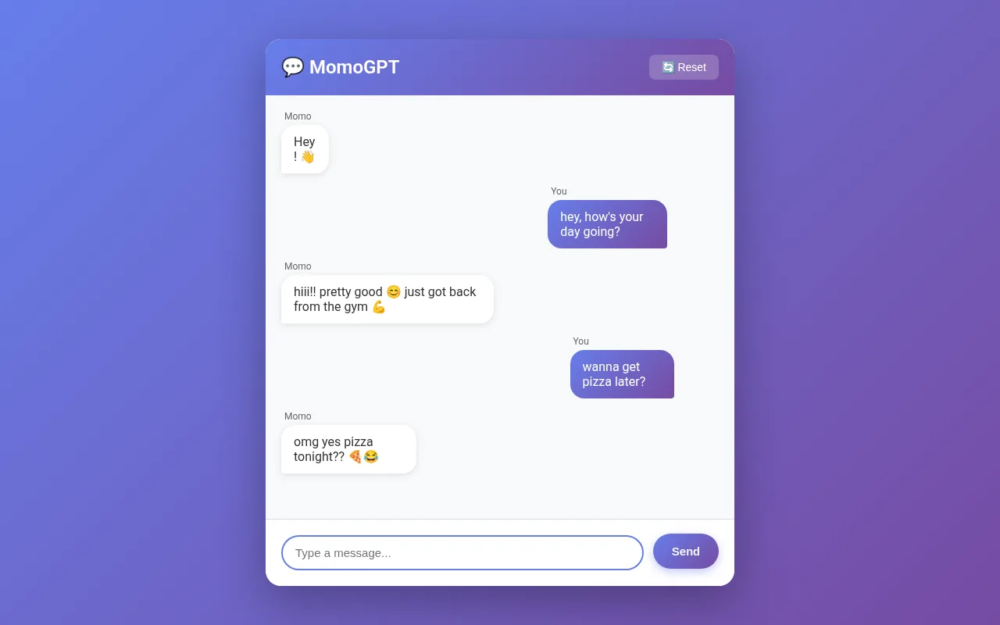

# momoGPT 💬

A Python chatbot that learns someone's texting style from a WhatsApp chat export, including their vocabulary, emoji habits, message length and punctuation, and then replies in that style. It runs on OpenAI, Anthropic, or **free** backends (local Ollama, Groq or OpenRouter).

**Live demo:** [akhilsingh2.github.io/momoGPT](https://akhilsingh2.github.io/momoGPT/). This is the web chat UI in demo mode with the bundled example persona: replies are canned samples in that persona's style, not model output. Train and chat for real by running it locally (`demo/build_demo.py` builds the page).

<p align="center"></p>
<p align="center"><sub>Web UI using the bundled example persona (replies stubbed for the screenshot).</sub></p>

> Only use chats you have permission to use. Real chat exports and the profiles generated from them are gitignored and never committed. This repo ships with a small made-up `example_chat.txt`.

## Features
- **WhatsApp export parser** (`parser.py`): handles the common date and time formats, multi-line messages and system lines, and groups messages by sender.
- **Personality analyzer** (`analyzer.py`): message length stats, signature words and phrases, favourite emojis, punctuation and enthusiasm, laughter frequency, topics, and response patterns. Writes `personality.json` and a generated `system_prompt.txt`.
- **Multi-chat training** (`train_multi_name.py`): merge several exports where the same person appears under different names.
- **Fine-tuning export** (`train.py --export-finetuning`): prompt/response pairs as JSONL.
- **Pluggable LLM backends**: OpenAI or Anthropic (`chatbot.py`), or free ones (`chatbot_local.py`), which auto-detects Ollama, then Groq, then OpenRouter.
- **Terminal chat and a Flask web UI** with conversation memory and reset.

## Tech stack
Python 3 · Flask · pandas and NumPy · OpenAI and Anthropic SDKs · Ollama, Groq and OpenRouter · vanilla HTML/CSS/JS chat UI

## Quick start
```bash
pip install -r requirements_free.txt        # or requirements.txt for OpenAI/Anthropic
cp .env.example .env                        # add a key, or install Ollama for fully local use

# 1. build a profile from a chat export (try the bundled example first)
python train.py --chat-file example_chat.txt --name Momo
#    several exports, same person under different names:
python train_multi_name.py --chat chat1.txt:Momo --chat chat2.txt:"Momo 2" --display-name Momo

# 2. chat
python chat_free.py        # terminal (free backends)   | python chat.py   (OpenAI/Anthropic)
python app_free.py         # web UI on http://localhost:5002 | python app.py  (port 5000)
```
`examples/` contains the `personality.json` and `system_prompt.txt` generated from `example_chat.txt`, so you can see the output format without training.

## How it works
```
WhatsApp export ─▶ parser.py ─▶ messages by sender ─▶ analyzer.py ─▶ personality.json + system_prompt.txt
                                                                         │
                                user message ─▶ chatbot(_local).py ◀─────┘ ─▶ LLM backend ─▶ reply in that style
```

## More docs
[Getting started](docs/GETTING_STARTED.md) · [Usage](docs/USAGE.md) · [Free AI setup](docs/FREE_AI_SETUP.md) · [Free mode](docs/FREE_MODE.md) · [Architecture](docs/ARCHITECTURE.md)
